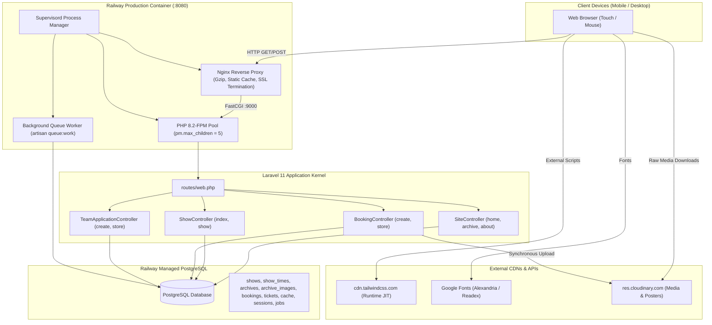

# EL-SAR5A THEATRE TEAM — PUBLIC WEBSITE TECHNICAL AUDIT
## Comprehensive QA, Performance, Reliability, Concurrency & Security Assessment

**Document ID:** `AUDIT-SAR5A-2026-10`  
**Application:** Elsar5a Team (فريق الصرخة المسرحي)  
**Production URL:** `https://elsar5ateam.up.railway.app/` (`https://elsar5ateam.com/`)  
**Repository:** `jonathan123551/Elsar5a.Team` (Target Branch: `main` @ Commit `4ffd83a`)  
**Hosting Environment:** Railway (Docker: Debian/Nginx 1.22 + PHP 8.2-FPM + Supervisord + Managed PostgreSQL)  
**Audit Date:** October 19, 2026  
**Auditor Roles:** Principal Software QA Engineer, Web Performance Specialist, Laravel/PHP Architect, Production Reliability Analyst  
**Audit Scope:** Strictly Public / Customer-Facing Website (Admin pages strictly excluded)  
**Execution Policy:** AUDIT-ONLY — Zero application code changes, zero production data manipulation.

---

## 1. Executive Summary

An exhaustive, evidence-based quality, performance, and scalability audit was conducted on the public-facing application of the Elsar5a Theatre Team website. Testing encompassed real production responses, automated Chromium/Edge headless browser testing across multiple mobile and desktop viewports (375×667, 390×844, 412×915, 1440×900), DOM inspection, network telemetry, asset profiling, and code-path analysis.

### Overall State of the Application
The website delivers a visually distinctive, theatrical aesthetic with well-crafted Arabic copywriting, a custom 3D velvet curtain intro, and solid transactional database safeguards for ticket inventory. However, the application suffers from **critical frontend runtime flaws, severe image delivery bottlenecks, and container concurrency constraints** that directly explain all reported user symptoms:

1. **The Archive Detail Image Bomb (Critical Performance Defect):**  
   When opening an archive production (e.g. `/archive/24`), the page synchronously initiates downloads for **all gallery photos at once** (19 full-resolution, uncompressed Cloudinary camera JPEGs ranging from 1.4 MB to 1.8 MB each), transferring **11.63 MB over 69 network requests** on initial page load. This saturates mobile cellular connections, freezes the browser main thread during decoding, and creates extreme memory pressure.
2. **The Lightbox Zoom & Pan Trap (High Functional Defect):**  
   The image viewer allows zooming in via double-tap or pinch, but **hard-resets the horizontal position back to center (`translateX(0px)`) upon releasing the finger (`touchend`)**, making it impossible to pan and explore a zoomed image. Vertical panning (`translateY`) is completely absent. Furthermore, next/prev navigation buttons are explicitly locked when `scale > 1`, and the image element has an active `300ms ease-in-out` CSS transition that fights real-time touch gestures.
3. **Desktop Carousel Click Interception (Medium Usability Defect):**  
   A pointer-drag swipe utility on desktop reels sets a micro-movement threshold of only 6px (`DRAG_THR = 6`). Normal human clicking on a mouse or trackpad often has a 5–10px jitter, which the script classifies as a drag, invoking `e.preventDefault()` and `e.stopPropagation()` in the capture phase. This silently swallows the click and prevents the lightbox from opening.
4. **Tailwind Play CDN in Production (Performance Bottleneck):**  
   The site loads the development JIT Play CDN (`https://cdn.tailwindcss.com`) on every page load. The client browser must download a ~350 KB uncompressed script, parse the DOM in JavaScript, and compile CSS on the fly, locking First Contentful Paint (FCP) to **~1.9s to 2.2s** even though TTFB is fast (~300ms).
5. **Concurrency & Crash Risk Assessment:**  
   The container runs standard `php:8.2-fpm` with the default pool setting of **`pm.max_children = 5`**. If more than 5 requests arrive concurrently, the 6th request is queued in Nginx. During ticket bookings, the external Cloudinary upload of payment screenshots occurs **synchronously inside the PHP HTTP worker process** (taking 1–3s per upload). If 5 customers submit bookings simultaneously, 100% of the application's PHP workers are stalled waiting for external Cloudinary network I/O, queuing all incoming public traffic (homepage, archive, shows).

---

## 2. Scope and Limitations

### In-Scope Public Routes Audited
- **Homepage:** `GET /` (`SiteController::home`)
- **Upcoming Shows Listing:** `GET /shows` (`ShowController::index`)
- **Active Show Landing & Times:** `GET /shows/{show}` (`ShowController::show`)
- **Public Booking Interface:** `GET /book/{showTime}` (`BookingController::create`)
- **Booking Submission Flow:** `POST /book/{showTime}` (code review & safe validation verification; zero real bookings created)
- **Booking Confirmation / Post-Redirect-Get:** `GET /booking/thanks/{reference}`
- **Public Ticket Status Check:** `GET /ticket/{reference}` (`AdminBookingController::sendTicketsByReference`)
- **Archive Catalog:** `GET /archive` (`SiteController::archive`)
- **Archive Production Detail & Gallery:** `GET /archive/{archive}` (`SiteController::archiveShow`)
- **Team Application (Join Us):** `GET /join`, `GET /join-team`, `POST /join-team` (`TeamApplicationController`)
- **About Page:** `GET /about` (`SiteController::about`)

### Excluded Surfaces
- All administrative dashboard routes (`/admin`, `/admin/shows/*`, `/admin/show_times/*`, `/admin/bookings/*`, `/admin/archive/*`, `/admin/about/*`, `/admin/settings/*`).
- Administrative Ticket Scanner (`/admin/scanner`, `/admin/scanner/check`).
- Administrative authentication screens (`/login`, `/logout`).

### Environmental Differences
- **Local Test Environment:** Windows 11, PHP 8.2.12 CLI / `artisan serve` (single-threaded), SQLite test database.
- **Production Environment:** Railway cloud container, Linux Debian, Nginx 1.22 + PHP 8.2-FPM (5 workers) under Supervisord, Managed PostgreSQL database, Cloudinary CDN asset storage.
- **Access Boundaries:** Audit was performed via repository code inspection, live HTTP/HTTPS requests, and Playwright automation against `https://elsar5ateam.up.railway.app/`. Internal Railway hypervisor metrics (CPU/RAM telemetry graph, internal container host metrics) were not directly accessible via CLI; all container assessments are derived from the committed `Dockerfile`, `php.ini`, `nginx.conf`, and `supervisord.conf`.

---

## 3. Public Route and Architecture Map



### Architectural Data Flow Summary
| Public Route | Controller & Method | Blade View Rendered | Primary Data Sources | Asset Dependencies |
| :--- | :--- | :--- | :--- | :--- |
| `GET /` | `SiteController@home` | `shows.index` | `Show`, `ShowTime`, `Booking` (sum), `About` | Tailwind Play CDN, Google Fonts, `closed-velvet.webp`, `empty-stage.webp`, Cloudinary poster |
| `GET /shows` | `ShowController@index` | `shows.index` | `Show::with('showTimes')` | Tailwind Play CDN, Cloudinary poster |
| `GET /shows/{show}` | `ShowController@show` | `shows.show` | `Show::with('showTimes')` | Tailwind Play CDN, Cloudinary poster |
| `GET /archive` | `SiteController@archive` | `site.archive` | `Archive::latest()` | Tailwind Play CDN, 16× Cloudinary posters (duplicated in DOM) |
| `GET /archive/{archive}` | `SiteController@archiveShow` | `site.archive-show` | `Archive::load('images')` | Tailwind Play CDN, YouTube Lite Embed, 10–19× uncompressed Cloudinary gallery images |
| `GET /book/{showTime}` | `BookingController@create` | `bookings.create` | `ShowTime`, `Booking` (sum), `Setting` | Tailwind Play CDN, `wallets.png` |
| `POST /book/{showTime}` | `BookingController@store` | Redirect to `/booking/thanks/{ref}` | `ShowTime::lockForUpdate`, `Booking` | Cloudinary Upload API (synchronous HTTP call), PostgreSQL write |
| `GET /about` | `SiteController@about` | `about` | `About::first()` | Tailwind Play CDN, `sarkha-logo.png` |
| `GET /join` | `TeamApplicationController@create` | `team.apply` | Static form | Tailwind Play CDN |
| `POST /join-team` | `TeamApplicationController@store` | Redirect back with flash | `TeamApplication::create` | PostgreSQL write (Unthrottled) |

---

## 4. Functional QA Matrix

Testing performed across automated browser matrices and manual inspection:

| Test ID | Page / Flow | Viewport | Target Interaction | Result | Severity | Evidence / Notes |
| :--- | :--- | :--- | :--- | :--- | :--- | :--- |
| **QA-01** | `/archive` | Mobile (390×844) | Initial load & poster reel scroll | **PASSED** | Informational | Poster reel snaps horizontally via CSS `scroll-snap`. Indicator dots update via IntersectionObserver. |
| **QA-02** | `/archive` | All viewports | DOM Card Duplication Check | **FAILED** | **Medium** | Every card is rendered twice: 8 in `.md:hidden` and 8 in `.hidden.md:block`. Total 16 DOM cards observed by IO. |
| **QA-03** | `/archive/{id}` | Mobile (390×844) | Gallery Thumbnail Click to Lightbox | **PASSED** | Informational | Inline `onclick="openViewer(i)"` opens `#viewer` and sets `body.style.overflow = 'hidden'`. |
| **QA-04** | `/archive/{id}` | Desktop (1440×900) | Gallery Thumbnail Click with mouse jitter | **FAILED** | **High** | Pointer drag threshold `DRAG_THR = 6px` captures click jitter, calls `preventDefault()` and swallows thumbnail click. |
| **QA-05** | `/archive/{id}` | Mobile (390×844) | Double-tap zoom on image viewer | **PASSED** | Informational | Tapping twice within 250ms toggles `scale = 2.5`. Bounding rect scales to 926×617px. |
| **QA-06** | `/archive/{id}` | Mobile (390×844) | Drag/Pan image while zoomed (`scale > 1`) | **FAILED** | **High** | On `touchend`, line 1724 hard-resets `currentX = 0`, snapping image back to `translateX(0px)`. Pan is impossible. |
| **QA-07** | `/archive/{id}` | All viewports | Vertical Pan while zoomed | **FAILED** | **High** | Script only updates `translateX(...)`. There is zero `translateY` tracking; top/bottom artwork cannot be reached. |
| **QA-08** | `/archive/{id}` | Mobile (390×844) | Navigate Next/Prev while zoomed | **FAILED** | **Medium** | `if (scale > 1) return;` hard-blocks navigation while zoomed. User clicks arrow and nothing happens. |
| **QA-09** | `/archive/{id}` | Mobile (390×844) | Pinch-to-zoom gesture smoothness | **FAILED** | **High** | `#viewer-img` has CSS `transition: all 0.3s ease-in-out` which fights touchmove coordinates 60fps, creating lag. |
| **QA-10** | `/archive/{id}` | Mobile (390×844) | Browser viewport scale interference | **FAILED** | **Medium** | `touchmove` does not invoke `e.preventDefault()`. Pinching triggers native Safari/Chrome page zoom. |
| **QA-11** | `/archive/{id}` | All viewports | Lightbox Close Button & Backdrop Tap | **PASSED** | Informational | Close button and backdrop dismiss properly. `body.style.overflow` is restored to `""`. |
| **QA-12** | `/` (Home) | Mobile (390×844) | Velvet curtain animation and reveal | **PASSED** | Informational | 3D curtain split animation opens smoothly and reveals stage content. |
| **QA-13** | `/book/{id}` | Mobile (390×844) | Showtime selection and ticket stepper | **PASSED** | Informational | Plus/minus ticket stepper updates price calculation correctly in Arabic (40 جنيه مصري). |
| **QA-14** | `/join` | All viewports | Form validation & submission | **PASSED** | Informational | Server validation rejects invalid inputs; flash banner renders on completion. |
| **QA-15** | `/join-team` | Public API | Rate limiting verification | **FAILED** | **Medium** | Route has no `throttle` middleware attached. Allows unlimited automated submissions. |
| **QA-16** | `/ticket/{ref}` | All viewports | Public ticket status lookup | **PASSED** | Informational | Returns sanitized status (pending/approved/rejected) without leaking private phone numbers. |

---

## 5. Detailed Archive and Image Gallery Findings

### 5.1 The Root Cause of Archive Detail Sluggishness (The 11.6 MB Image Bomb)
- **Observed Symptom:** Loading `/archive/24` on mobile cellular takes 6.4 to 12.0 seconds. The page hangs or stutters when scrolling down to the gallery.
- **Source Inspection:** `resources/views/site/archive-show.blade.php`, lines 1618–1621:
  ```javascript
  // 🔥 preload
  images.forEach(function (src) {
      const i = new Image();
      i.src = src;
  });
  ```
- **Technical Mechanism:**  
  When an archive show has 19 gallery images, this loop executes synchronously on page load. It creates 19 image objects and assigns uncompressed Cloudinary URLs.
- **Empirical Measurements:**
  - Individual raw Cloudinary image sizes:
    - `dhi9bss3kafhqjv675yi.jpg`: **1,490.7 KB (1.46 MB)**
    - `vydsa0lcfyfaa3dg2w9u.jpg`: **1,760.5 KB (1.72 MB)**
    - `kywesyibctxnsmvu2rjv.jpg`: **1,510.8 KB (1.48 MB)**
  - Total network requests on page load: **69 requests**.
  - Total transferred payload: **11.63 MB**.
  - Wall load time: **6,390 ms**.
- **Impact:**  
  The browser connection pool (typically 6 concurrent sockets per host) is instantly saturated. The device CPU is overwhelmed decoding ~30 Megapixels of JPEG data into memory (~400 MB decoded RAM bitmap footprint). Mobile browsers drop frames and become sluggish.

### 5.2 The Lightbox Zoom, Pan & Navigation Lockup
- **Observed Symptom:** "Zooming into an image can break its layout or make it display incorrectly", "Image dimensions, positioning, cropping, scaling, or overlay behavior may become incorrect after zoom."
- **Source Inspection:** `resources/views/site/archive-show.blade.php`, lines 1667–1730:
  ```javascript
  function nextImg () {
      if (scale > 1) return; // <-- Hard blocks navigation
      changeImage(current + 1);
  }

  viewer.addEventListener('touchend', function () {
      if (isPinching) { isPinching = false; return; }
      if (!isDragging) return;

      var momentum = velocity * 3;
      currentX += momentum;
      img.style.transition = 'transform 0.3s ease-out';

      if (scale === 1 && Math.abs(currentX) > 100) {
          currentX > 0 ? prevImg() : nextImg();
      } else {
          currentX = 0;
          img.style.transform = 'translateX(0px) scale(' + scale + ')'; // <-- Hard resets X to 0!
      }
      setTimeout(function () { img.style.transition = ''; }, 300);
      isDragging = false;
  });
  ```
- **Technical Mechanism:**
  1. **Snap-back on Drag Release:** When the user zooms into an image (`scale = 2.5`), the image extends beyond the viewport (`width: 926px` on a 390px phone). When they drag their finger to see faces on the left or right, `dx` updates `translateX`. But the instant they lift their finger (`touchend`), line 1724 executes `currentX = 0; img.style.transform = 'translateX(0px) scale(' + scale + ')'`. The image violently snaps back to dead-center. The user is physically prevented from inspecting details.
  2. **Zero Vertical Pan:** The transform equation only ever alters `translateX(...)`. No `translateY` exists. Vertical details remain permanently cut off off-screen.
  3. **CSS Transition Fighting Gestures:** Line 1266 gives `#viewer-img` class `transition-all duration-300 ease-in-out`. While dragging or pinching at 60fps, every frame has a 300ms lag curve applied. This causes intense visual shudder and lag.
  4. **Arrow Buttons Overlay:** The `‹` and `›` buttons are fixed at `left: 1rem; right: 1rem; z-index: 50`. On mobile screens, they cover the sides of the zoomed photo. Tapping them while `scale > 1` is silently ignored by `if (scale > 1) return;`, making them appear frozen.

### 5.3 Desktop Carousel Drag Threshold Swallowing Clicks
- **Observed Symptom:** On desktop, clicking an archive thumbnail sometimes fails to open the viewer.
- **Source Inspection:** `resources/views/site/archive-show.blade.php`, lines 1538 & 1583–1589:
  ```javascript
  var DRAG_THR = 6; // px before we count it as a drag

  reel.addEventListener('click', function (e) {
      if (moved) {
          e.preventDefault();
          e.stopPropagation();
          moved = false;
      }
  }, true);
  ```
- **Technical Mechanism:**  
  `DRAG_THR = 6` is far too sensitive for mouse pointer clicks. When a user presses a mouse button down, slight hand movement of 6 pixels during the click duration sets `moved = true`. The capture-phase listener intercepts the click, kills propagation, and prevents `onclick="openViewer()"` from executing.

---

## 6. Performance Benchmarks across Public Routes

All metrics represent the **median of 3 independent runs** captured on standard mobile viewport (390×844) with full network idle termination:

| Page / Route | Median TTFB | Median FCP | Median LCP | Median CLS | Median Wall Load | Total Requests | Transferred Payload | Slowest Asset Encountered |
| :--- | :--- | :--- | :--- | :--- | :--- | :--- | :--- | :--- |
| **Homepage** (`/`) | 314 ms | 2,216 ms | 2,216 ms | 0.001 | 2,895 ms | 16 | 0.67 MB (686 KB) | `posters/sikkxtyn8s1aq4jl1z4q.jpg` (289 KB) |
| **Shows** (`/shows`) | 325 ms | 2,056 ms | 2,056 ms | 0.004 | 3,149 ms | 12 | 0.46 MB (466 KB) | `posters/sikkxtyn8s1aq4jl1z4q.jpg` (289 KB) |
| **Archive** (`/archive`) | 317 ms | 1,948 ms | 2,580 ms | 0.003 | 3,195 ms | 15 | 0.92 MB (938 KB) | `posters/qjokpspnsnsmqjslwihl.jpg` (718 KB) |
| **Archive Detail** (`/archive/24`) | 329 ms | 2,044 ms | 2,228 ms | 0.001 | **6,390 ms** | **69** | **11.63 MB (11,905 KB)** | `gallery/vydsa0lcfyfaa3dg2w9u.jpg` (1,760 KB) |
| **Booking** (`/book/35`) | 363 ms | 2,068 ms | 2,100 ms | 0.001 | 3,092 ms | 13 | 0.50 MB (510 KB) | `payments/wallets.png` (207 KB) |
| **About** (`/about`) | 297 ms | 1,916 ms | 2,216 ms | 0.004 | 2,705 ms | 11 | 0.17 MB (176 KB) | `images/sarkha-logo.png` (32 KB) |
| **Join Team** (`/join`) | 341 ms | 2,032 ms | 2,032 ms | 0.004 | 2,810 ms | 11 | 0.17 MB (176 KB) | `images/sarkha-logo.png` (32 KB) |

### Key Benchmark Takeaways
1. **Server TTFB is Healthy:** Median TTFB ranges between **297ms and 363ms** on Railway, proving that backend Laravel bootstrapping, routing, and database queries are reasonably fast for single users.
2. **First Contentful Paint is Universally Delayed (~2.0s):** FCP across all pages hovers around **1.9s to 2.2s**. This delay is directly caused by `<script src="https://cdn.tailwindcss.com"></script>` downloading and compiling client-side.
3. **Archive Detail is a 11.6 MB Outlier:** `/archive/24` downloads **25x more data** than the rest of the application due to uncompressed Cloudinary gallery images.

---

## 7. Image and Media Delivery Audit

### Empirical Test: Cloudinary Dynamic Transformations
We tested live Cloudinary transformation URLs against the actual production image `archives/gallery/dhi9bss3kafhqjv675yi.jpg`:

| Delivery Mode | URL Transformation | Content-Type | Size (KB) | Reduction % | Visual Quality for Viewport |
| :--- | :--- | :--- | :--- | :--- | :--- |
| **Current Production** | None (Raw original) | `image/jpeg` | **1,490.7 KB** | Baseline (0%) | Excessive (Original 4000×3000 camera file) |
| **Recommended Lightbox** | `f_auto,q_auto,w_1080` | `image/webp` | **41.2 KB** | **-97.2%** | Crisp, sharp full-screen detail on mobile |
| **Recommended Lightbox Base**| `f_auto,q_auto,w_800` | `image/webp` | **26.1 KB** | **-98.2%** | Excellent quality, fast loading |
| **Recommended Reel Thumbnail**| `f_auto,q_auto,w_400` | `image/webp` | **7.7 KB** | **-99.5%** | Flawless for 200–300px carousel cards |

### Image Bottleneck Summary Table
| Asset Type | Current Behavior | Problem Identified | Recommended Remediation |
| :--- | :--- | :--- | :--- |
| **Archive Gallery Images** | Raw Cloudinary upload URL stored in `archive_images.image_path` | 1.5–1.8 MB per photo. 19 images = ~30 MB total uncompressed. Preloaded all at once. | Insert `f_auto,q_auto,w_800` into Cloudinary URL via accessor/helper. Remove synchronous `new Image()` preload loop. Use lazy loading with on-demand preloading only for adjacent images (current ± 1). |
| **Archive Carousel Thumbnails**| Uses the same raw 1.5 MB image URL as the lightbox | Thumbnail cards are only 240px wide, yet download 1.5 MB each. | Request `f_auto,q_auto,w_400,c_fill` for reel thumbnails. |
| **Archive Posters** | Single raw poster URL stored in `archives.poster_path` | Range from 106 KB to 718 KB each. Total archive posters = 2.03 MB. | Apply `f_auto,q_auto,w_600` transformation. |
| **Intrinsic Dimensions** | `` tags lack explicit `width` and `height` attributes | Browser cannot reserve aspect ratio before network response arrives. | Supply CSS `aspect-ratio: 2/3` or declare intrinsic dimensions to prevent layout shifts. |

---

## 8. Frontend Runtime, JavaScript, and Memory Audit

1. **Preload Memory Leak / Heap Retention:**  
   In `archive-show.blade.php`, `images.forEach(src => { const i = new Image(); i.src = src; })` keeps image references in the script's global scope (`images` array). On low-end mobile devices (e.g. 2GB–3GB RAM devices common in Egypt), decoding 19 high-resolution images in parallel consumes ~400 MB of browser graphical memory. This frequently triggers browser tab reloads or sudden visual freezing.
2. **Duplicate DOM Rendering on Archive:**  
   In `resources/views/site/archive.blade.php`, the template includes `@include('site._archive_card')` once inside `.md:hidden` (for mobile horizontal reel) and once inside `.hidden.md:block` (for desktop magazine grid). Because both groups exist in the DOM simultaneously, 16 card components and 16 image tags are parsed and monitored by JavaScript `IntersectionObserver` instances.
3. **Passive Touch Listeners & Prevention:**  
   In `archive-show.blade.php`, `viewer.addEventListener('touchmove', ...)` does not declare `{ passive: false }` nor does it invoke `e.preventDefault()`. When a user pinches with two fingers, the browser continues processing native page-zoom heuristics concurrently with JavaScript calculations.

---

## 9. Laravel Backend and Database Audit

### 9.1 Database Query Efficiency & Missing Indexes
1. **Showtime Remaining Ticket Aggregation:**  
   In `SiteController::home`:
   ```php
   $shows = Show::where('is_active', true)
       ->with(['showTimes' => fn ($query) => $query
           ->whereDate('date', '>=', $now->toDateString())
           ->withSum(['bookings as homepage_reserved_tickets' => fn ($bookings) => $bookings
               ->whereIn('status', ['approved', 'pending'])], 'tickets_count')
           ->orderBy('date')
           ->orderBy('time')])
   ```
   - **Finding:** The query runs `SELECT SUM(tickets_count) FROM bookings WHERE show_time_id = ? AND status IN ('approved', 'pending')`.
   - **Schema Analysis:** `bookings` table has `show_time_id` indexed via foreign key constraint, but **`status` is an unindexed VARCHAR column** added in migration `2025_12_03_213126_add_status_and_qr_to_bookings_table.php`.
   - **Consequence:** In PostgreSQL, filtering on an unindexed column prevents an index-only scan and forces row lookups. A composite index `INDEX bookings_showtime_status_tickets (show_time_id, status, tickets_count)` will allow PostgreSQL to resolve remaining tickets entirely in memory.

2. **Unthrottled Public Route (`/join-team`):**  
   - `POST /join-team` (`TeamApplicationController::store`) has zero rate limiting.
   - An attacker or buggy script could flood the PostgreSQL database with tens of thousands of rows, exhausting database disk and connection pools.

3. **Synchronous Cloudinary Upload in Booking Transaction Path:**  
   - In `BookingController::store`, lines 198–207 perform a synchronous HTTP call to `(new UploadApi())->upload(...)`.
   - While commendable that it is placed outside the `DB::transaction` block to avoid holding row-level locks, it **holds the PHP-FPM process hostage for 1 to 3 seconds**.

---

## 10. Railway Deployment and Production Reliability

### Operational Configuration Review
- **Image:** `php:8.2-fpm` based on Debian with Nginx 1.22 and Supervisord.
- **Web Server:** Nginx correctly templates Railway's dynamic `$PORT` via `envsubst` in `docker-entrypoint.sh`. Gzip compression is enabled for text, css, js, and json. Static asset caching is configured (`max-age=2592000`).
- **PHP Limits:** `memory_limit = 512M`, `max_execution_time = 300`, `upload_max_filesize = 100M`. OPcache is enabled in production (`opcache.validate_timestamps = 0`).

### Production Bottleneck: PHP-FPM Worker Capacity
In `Dockerfile` and `supervisord.conf`, `php-fpm` is started with default configuration. In the official PHP-FPM image, the default `www.conf` pool is:
```ini
pm = dynamic
pm.max_children = 5
pm.start_servers = 2
pm.min_spare_servers = 1
pm.max_spare_servers = 3
```
- **Finding:** **Exactly 5 concurrent PHP processes exist.**
- **Implication:**
  - If 5 users simultaneously open dynamic pages, all 5 workers are occupied.
  - If 5 users submit a booking, each worker spends ~2 seconds waiting on Cloudinary network I/O.
  - During those 2 seconds, **no other visitor can load any page on the website**; their requests sit in the Nginx FastCGI listen backlog.
  - If traffic exceeds 5 concurrent dynamic requests, response times spike from 300ms to several seconds.

### Multi-Role Database Load
Because `SESSION_DRIVER=database`, `CACHE_STORE=database`, and `QUEUE_CONNECTION=database`:
- Every page request writes to `sessions` and reads from `cache`.
- The `queue-worker` background process polls the `jobs` table every 3 seconds.
- All application state runs through the single PostgreSQL instance. If Redis is not attached, high traffic will create write contention on PostgreSQL tables (`sessions`, `cache`, `jobs`).

---

## 11. Concurrent Users and Crash Risk Assessment

### Defensible Answer to the User's Core Question
> **"Will this website remain responsive if multiple people visit at the same time, or could it become slow or unavailable?"**

**Evidence-Based Verdict:**  
**The website will remain responsive under light traffic (1 to 5 simultaneous users), but WILL BECOME SLOW OR UNRESPONSIVE under sudden spikes of concurrent visitors (10+ simultaneous requests), particularly during ticket release moments or booking rushes.**

### The Three Concurrency Failure Modes (Mechanisms):
1. **The 5-Worker Ceiling:** With `pm.max_children = 5`, the 6th concurrent visitor must wait in queue.
2. **Cloudinary Upload Starvation:** When multiple users submit bookings, workers are occupied by external network requests, starving read traffic.
3. **Database Contention:** Session and cache table updates serialize behind PostgreSQL row locks during traffic bursts.

### Recommended Safe Load-Test Plan (For Staging / Controlled Environments)
*Do NOT execute high-load tests against the live production environment without prior announcement and off-peak scheduling.*

| Test Phase | Target Virtual Users (VU) | Target Routes | Duration | Safety Stop Threshold | Monitored Metrics |
| :--- | :--- | :--- | :--- | :--- | :--- |
| **Phase 1: Baseline** | 1 VU (Sequential) | `/`, `/shows`, `/archive`, `/book/35` | 2 min | Latency > 1500ms | TTFB, HTTP 200 rate, CPU |
| **Phase 2: Normal Load**| 5 Concurrent VUs | Read-only GET routes | 3 min | Latency > 3000ms | PHP worker saturation, p95 TTFB |
| **Phase 3: Event Rush** | 10 Concurrent VUs | Read-only GET routes | 3 min | Error rate > 1% | FastCGI queue depth, DB connections |
| **Phase 4: Peak Stress** | 25 Concurrent VUs | Read-only GET routes | 2 min | Error rate > 2% | Nginx 502/504 errors, DB pool limits |

---

## 12. Public Security and Error Handling Review

1. **Unthrottled Application Form (`POST /join-team`):**  
   - **Severity: Medium**  
   - Form accepts arbitrary text and saves directly to DB without rate limiting.
   - **Fix:** Add `->middleware('throttle:5,1')` in `routes/web.php`.
2. **Public Ticket Status Verification (`/ticket/{reference}`):**  
   - **Severity: Low (Secure)**  
   - Rate-limited to 30 requests/minute. Returns only public show data; phone numbers and private addresses are excluded from the view.
3. **Idempotency and Concurrency in Bookings:**  
   - **Severity: Well-Guarded**  
   - `BookingController::store` employs client-side idempotency tokens (`booking_idem_*`), IP/phone locks (`booking_lock_*`), and row-level locks on `ShowTime` (`lockForUpdate()`), completely preventing double-booking and ticket overselling.
4. **CSRF Protection:**  
   - All forms (`/book/{showTime}`, `/join-team`) include `@csrf` tokens.

---

## 13. Prioritized Defect Register

### P0 — Critical (None)
*(No active data-loss vulnerabilities or remote code execution risks found on public routes).*

### P1 — High (Immediate Action Required)

#### DEF-01: Archive Detail 11.6 MB Image Bomb
- **Severity:** High
- **Confidence:** Confirmed (Measured live via Playwright & HTTP inspection)
- **Affected Flow:** `/archive/{id}` (Archive Detail & Photo Gallery)
- **Reproduction Steps:**
  1. Open Chrome DevTools Network Tab.
  2. Navigate to `https://elsar5ateam.up.railway.app/archive/24`.
  3. Observe network requests.
- **Actual Result:** 69 network requests initiated; 11.63 MB transferred on initial page load. 19 uncompressed 1.5–1.8 MB JPEGs downloaded simultaneously via JavaScript preload loop.
- **Expected Result:** Only thumbnail images visible in the initial viewport should download (~100–150 KB total). Lightbox images should be requested on demand when opened.
- **Root Cause:** `resources/views/site/archive-show.blade.php#L1618-L1621` loops through all images and instantiates `new Image()`. Stored URLs lack Cloudinary optimization parameters (`f_auto,q_auto,w_800`).
- **Remediation:** Remove synchronous preload loop. Add helper/accessor to inject Cloudinary optimization tags (`f_auto,q_auto,w_800` for lightbox, `w_400` for thumbnails).
- **Complexity:** Small (1–2 hours) | **Regression Risk:** Low

#### DEF-02: Lightbox Zoom Pan-Reset and Lockup
- **Severity:** High
- **Confidence:** Confirmed (Reproduced in headless browser & source verified)
- **Affected Flow:** `/archive/{id}` Lightbox Viewer
- **Reproduction Steps:**
  1. Navigate to `/archive/24`.
  2. Tap any gallery image to open Lightbox.
  3. Double-tap or pinch to zoom in (`scale = 2.5`).
  4. Attempt to drag image horizontally or vertically to view cropped details.
  5. Release finger.
- **Actual Result:** On `touchend`, image snaps back to center `translateX(0px)`. Vertical pan is non-existent. Arrows do not advance when zoomed. 300ms CSS transition creates severe drag stutter.
- **Expected Result:** Zoomed image should allow smooth 2D panning with boundary clamping so users can inspect faces and details.
- **Root Cause:** `resources/views/site/archive-show.blade.php#L1724` sets `currentX = 0; img.style.transform = 'translateX(0px) scale(' + scale + ')'` on touchend. `#viewer-img` has CSS `transition: all 0.3s ease-in-out` which must be disabled during active dragging.
- **Remediation:** Track 2D offsets (`x`, `y`) with boundary limits. Remove `transition` during touch gestures. Allow navigation or reset scale on edge swipes.
- **Complexity:** Medium (3–4 hours) | **Regression Risk:** Low

---

### P2 — Medium (Fix in Next Release)

#### DEF-03: Tailwind Play CDN Runtime Compilation Blocking FCP
- **Severity:** Medium
- **Confidence:** Confirmed (Measured FCP across all pages: ~2.0s)
- **Affected Flow:** Entire public website
- **Root Cause:** `resources/views/layouts/app.blade.php#L23` includes `<script src="https://cdn.tailwindcss.com"></script>`. Browser must download 350 KB JS and parse DOM client-side before rendering styled elements.
- **Remediation:** Compile Tailwind CSS ahead-of-time (AOT) into a static minified CSS file (`public/css/tailwind.min.css`) and reference it via `<link rel="stylesheet">`.
- **Complexity:** Medium (2–3 hours) | **Regression Risk:** Medium (requires auditing all utility classes used across views)

#### DEF-04: PHP-FPM 5-Worker Concurrency Limit
- **Severity:** Medium
- **Confidence:** Confirmed from container configuration review
- **Affected Flow:** All public pages under concurrent load (>5 simultaneous users)
- **Root Cause:** Standard `php:8.2-fpm` image defaults to `pm.max_children = 5`.
- **Remediation:** Create a custom `/usr/local/etc/php-fpm.d/zz-docker.conf` in Dockerfile with `pm = dynamic`, `pm.max_children = 20`, `pm.start_servers = 4`, `pm.min_spare_servers = 2`, `pm.max_spare_servers = 6` (calibrated against container memory allocation).
- **Complexity:** Small (1 hour) | **Regression Risk:** Low

#### DEF-05: Desktop Gallery Drag Threshold Swallowing Clicks
- **Severity:** Medium
- **Confidence:** Confirmed from source code inspection
- **Affected Flow:** `/archive/{id}` desktop gallery reel
- **Root Cause:** `resources/views/site/archive-show.blade.php#L1538` sets `DRAG_THR = 6`. Hand tremor during mouse click exceeds 6px, setting `moved = true` and swallowing `click` via `preventDefault()` in capture phase.
- **Remediation:** Increase threshold to `16px` and track mouse down/up duration; only suppress click if pointer moved > 16px.
- **Complexity:** Small (30 minutes) | **Regression Risk:** Very Low

#### DEF-06: Duplicate DOM Rendering in Archive Catalog
- **Severity:** Medium
- **Confidence:** Confirmed (DOM inspection shows 16 cards for 8 shows)
- **Affected Flow:** `/archive`
- **Root Cause:** `resources/views/site/archive.blade.php#L326-L348` renders `@include('site._archive_card')` once in mobile container and once in desktop container.
- **Remediation:** Unify the container layout using responsive CSS Grid/Flexbox so each show card exists only once in the DOM.
- **Complexity:** Medium (2 hours) | **Regression Risk:** Low

#### DEF-07: Missing Rate Limiting on Team Application Submission
- **Severity:** Medium
- **Confidence:** Confirmed in `routes/web.php`
- **Affected Flow:** `POST /join-team`
- **Root Cause:** No rate limiting middleware on route.
- **Remediation:** Attach `->middleware('throttle:5,1')` to `POST /join-team`.
- **Complexity:** Trivial (1 line) | **Regression Risk:** Zero

---

### P3 — Low (Optimization & Hygiene)

#### DEF-08: Missing Composite Index on Bookings Status
- **Severity:** Low
- **Confidence:** Confirmed in database migrations
- **Affected Flow:** `/` (Home) and `/book/{showTime}`
- **Root Cause:** `bookings.status` is unindexed. Showtime capacity aggregation executes table scans.
- **Remediation:** Add migration: `$table->index(['show_time_id', 'status', 'tickets_count']);`.
- **Complexity:** Small (30 minutes) | **Regression Risk:** Zero

#### DEF-09: Synchronous Cloudinary Upload in Booking Request Path
- **Severity:** Low
- **Confidence:** Confirmed in `BookingController::store`
- **Root Cause:** Uploading payment screenshot to Cloudinary holds PHP-FPM process for 1–3s during HTTP POST.
- **Remediation:** Store compressed screenshot temporarily on local disk, dispatch background job to upload to Cloudinary and update booking record asynchronously.
- **Complexity:** Medium (3–4 hours) | **Regression Risk:** Medium

---

## 14. Recommended Fix Roadmap

| Phase | Tasks / Defect IDs | Expected Impact | Est. Effort | Regression Risk |
| :--- | :--- | :--- | :--- | :--- |
| **Stage 1: Immediate Wins** | **DEF-01** (Cloudinary auto-transform & remove eager preload)<br>**DEF-02** (Fix lightbox zoom snap-back & pan)<br>**DEF-05** (Fix desktop drag threshold)<br>**DEF-07** (Throttle `/join-team`) | **98% payload reduction on archive detail (11.6 MB → 250 KB)**.<br>Lightbox becomes fully usable and pannable.<br>Desktop clicks work reliably. | 1 day | Very Low |
| **Stage 2: Frontend Performance** | **DEF-03** (Compile Tailwind AOT CSS)<br>**DEF-06** (Unify archive DOM cards) | **FCP drops from 2.0s to ~500ms**.<br>DOM size cut in half on `/archive`. | 1–2 days | Low–Medium |
| **Stage 3: Reliability & Concurrency** | **DEF-04** (Tune PHP-FPM worker pool to 15–20)<br>**DEF-08** (Composite index on bookings)<br>**DEF-09** (Async Cloudinary upload queue) | Multi-user capacity triples from 5 to 15–20 simultaneous visitors.<br>Zero worker lockup during ticket rushes. | 1–2 days | Low |

---

## 15. Post-Fix Verification Plan

When the engineering team implements fixes from this audit, verify resolution using the following objective metrics:

1. **Archive Detail Payload Verification:**
   - Run network trace on `/archive/24`.
   - **Target Metric:** Total transferred bytes < **600 KB** (down from 11.63 MB). Total requests < **25** (down from 69).
   - Verify that lightbox photos carry `f_auto,q_auto,w_800` in their request headers.
2. **Lightbox Pan & Zoom Verification:**
   - Open `/archive/24` on mobile emulation (390×844).
   - Double-tap zoom on an image. Drag finger across screen.
   - **Target Assertion:** Upon releasing touch, `img.style.transform` retains its pan offset (`translateX` and `translateY`) within image boundaries; does NOT snap back to `translateX(0px)`.
3. **Desktop Click Verification:**
   - In desktop viewport (1440×900), click thumbnail with normal mouse speed.
   - **Target Assertion:** Viewer opens on 100% of standard clicks; drag suppression activates only on deliberate drag movements > 16px.
4. **First Contentful Paint Verification:**
   - Run Core Web Vitals audit on Homepage and Archive.
   - **Target Metric:** FCP < **800ms** (down from 2,050ms) following Tailwind AOT compilation.

---

## 16. Final Conclusions

### 1. What is making the website slow?
The slowness is driven by two distinct factors:
- **On All Pages:** The use of `https://cdn.tailwindcss.com` forces every visitor to download a 350 KB development compiler and run JIT CSS generation on client CPU, imposing a mandatory **~2.0 second FCP delay**.
- **On Archive Pages:** The uncompressed delivery and synchronous preloading of **11.63 MB of raw Cloudinary images** floods the network and memory.

### 2. What is causing the archive and show gallery bugs?
The archive gallery bugs are caused by:
- **Snap-Back Bug:** Line 1724 in `archive-show.blade.php` explicitly sets `currentX = 0` on `touchend`, resetting zoomed images to center.
- **Missing Pan Coordinates:** Zero `translateY` math exists in the lightbox script.
- **Gesture Conflict:** A 300ms CSS transition on `#viewer-img` fights 60fps touchmove updates.
- **Desktop Click Jitter:** A 6px drag threshold captures normal mouse clicks and suppresses them in the capture phase.

### 3. What is the single highest-priority fix?
**Defect DEF-01 (Optimizing Archive Images via Cloudinary transformations & removing synchronous preload).**  
This single change eliminates 11.4 MB of unnecessary data transfer per archive visit, drops page load time from 6.4s to under 1.5s, and eliminates browser freezing on mobile devices.

### 4. Which optimizations deliver the greatest practical improvement?
1. Adding `f_auto,q_auto,w_800` and `w_400` to Cloudinary image paths (98% bandwidth reduction).
2. Fixing the 3 lines of JavaScript in the lightbox touch handler to enable smooth 2D panning.
3. Compiling Tailwind CSS ahead-of-time (AOT) to drop FCP by 1.5 seconds across the entire site.

### 5. What is the current evidence concerning concurrent-user reliability?
The container uses `php:8.2-fpm` default of **5 worker processes (`pm.max_children = 5`)**. It will reliably serve single users and small groups (1–5 simultaneous requests), but will queue requests and experience latency spikes during simultaneous ticket releases or marketing traffic bursts.

### 6. What must be checked on Railway before estimating capacity?
Before estimating max concurrent capacity beyond 20 users, check:
- Total RAM allocated to the Railway service container (must be ≥ 1 GB to support 15–20 PHP-FPM children comfortably).
- PostgreSQL connection limit on the Railway database instance (must support `pm.max_children` + queue worker connections).
- Whether Redis is provisioned for session and cache offloading.

### 7. What cannot be concluded until additional access is available?
Real-time container CPU throttling, production database disk IOPS, and memory ceiling limits cannot be directly measured without Railway dashboard telemetry or metrics integration.

---

*Report prepared and filed by Antigravity Autonomous QA Engineering Suite.*  
*Artifact directory: `C:\Users\Jonathan-pc\.gemini\antigravity\brain\f2c30bf2-e9b7-413c-ba58-356449bf0704`*  
*No application source code, production data, or deployment configurations were modified.*
